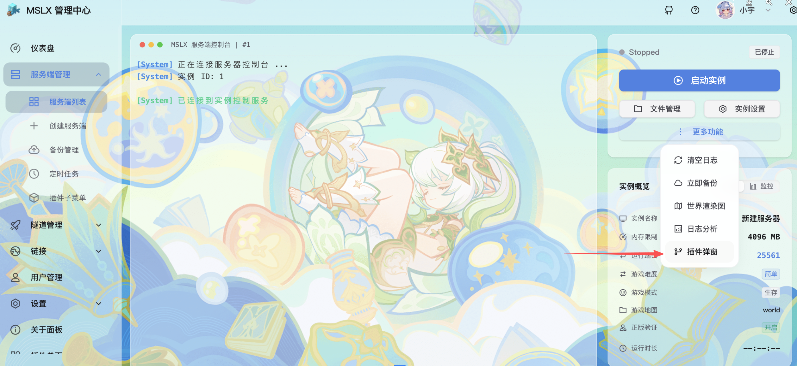
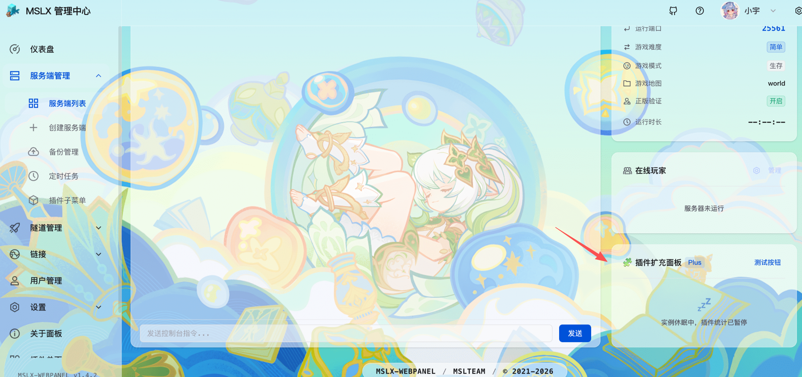
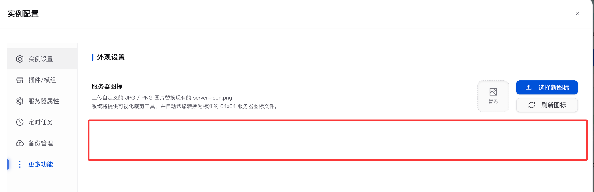

## 概述

::: important 视觉设计规范与原页面一致性要求
使用插槽注入自定义组件时，请务必保证视觉风格与宿主原页面高度一致：
1. **根卡片类名**：自定义卡片必须包含 `class="design-card ..."`，禁止使用 `bg-white` 硬编码纯白背景，以保证暗黑模式与用户自定义壁纸毛玻璃透明度的正常生效。
2. **弹窗层级**：若注入包含 `<t-dialog>` 弹窗，必须声明 `attach="body"` 避免被父容器截断，并使用响应式宽度 `width="min(580px, 92vw)"`。
3. **官方规范 Skill**：推荐搭配官方 AI 开发规范进行辅助编码与工程合规性自检。

[>>> 查阅接入指南与安装说明 **插件开发 AI SKILL**](/plugin-dev/init/ai-skill/){.read-more}
:::

MSLX 的插件系统允许您在原有页面的一些槽位新增组件/插入下拉菜单，效果如下：


新增的组件注入均在插件的 ==入口文件== 中导出的 `pluginConfig` 集合中的 `extensions` 数组。

具体示例可参考 ==mslx-plugin-demo== 插件的插件入口示例：[mslx-plugin-demo/Frontend/src/pluginEntry.ts at main · MSLTeam/mslx-plugin-demo](https://github.com/MSLTeam/mslx-plugin-demo/blob/main/Frontend/src/pluginEntry.ts)

本文档将展示所有支持的插槽。其中徽章指示代表该插槽支持的最低MSLX SDK版本。<Badge color="#8e5cd9" bg-color="rgba(159, 122, 234, 0.16)" text="Version" />

## 配置示例

:::: field-group

::: field extensions[i].slot
@type string
@required
插槽名字（见本文档）
:::

::: field extensions[i].component
@type string
@required
嵌入的组件（需要在上方import）
:::

::::

以上两项为插槽的通用配置，如插槽有其他配置项（例如`label`）,会在下方文档补充说明。

```ts
    extensions: [
        {
            slot: 'header-action', // 顶部快捷操作 (v1.7.9+)
            type: 'dropdown',
            id: 'tools',
            label: '快捷工具',
            icon: 'app',
            items: [ /* 抽屉、悬浮窗、路由、外链或操作 */ ]
        },
        {
            slot: 'instance-console-dropdown', // 注入到实例控制台更多功能的下拉菜单
            component: InstanceDropDownItemInject, // 弹窗组件
            label: '插件弹窗', // 下拉子菜单名
            icon: GitBranchIcon, // 下拉子菜单Icon
        },
        {
            slot: 'instance-console-overview-bottom', // 注入到实例控制台玩家卡片下方
            component: InstanceCardInject, // 组件
        }
    ]
```


## 全局-顶部导航栏快捷操作插槽

插槽名：`header-action` <Badge type="tip" text="v1.7.9" />

MSLX 允许插件在面板顶部导航栏（Header 右侧全局操作区）注入快捷入口，支持侧滑抽屉、可拖拽悬浮窗、页面快速跳转、外部安全链接、异步操作回调以及多级下拉菜单。

### 双端自适应展示规则

顶部操作区针对 PC 桌面端与手机移动端做了智能响应式自适应：

* **桌面端 (屏幕宽度 ≥ 1024px)**：
  * 直显**第一个**符合角色权限且未显式声明 `placement: 'more'` 的入口（作为独立图标按钮或下拉菜单直接显示在顶部工具栏）。
  * 其它顶层入口以及显式声明了 `placement: 'more'` 的入口，会自动收纳在 **「更多操作」**（`more`）下拉菜单中。
* **移动端 (屏幕宽度 < 1024px)**：
  * 为保障手机小屏的排版体验，所有插件入口均收拢在 **「更多操作」** 菜单中，与宿主系统功能（GitHub、CNB、后台任务、帮助文档、系统设置）无缝融合。

### 支持的 6 大动作类型 (`type`)

`header-action` 支持通过 `type` 字段指定不同的交互形态：

| `type` | 类型说明 | 专属参数与行为规范 |
| :--- | :--- | :--- |
| **`drawer`** | 侧边抽屉面板 | `component` 传入抽屉组件。组件接收布尔型 `props: { visible: Boolean }`，关闭时发送 `emit('update:visible', false)`。推荐使用 `<t-drawer attach="body">`。 |
| **`floating`** | 自定义悬浮窗 | `component` 传入悬浮窗组件。同样接收 `visible` prop 与 `update:visible` 事件。推荐结合 `<teleport to="body">`、固定定位与拖动手柄实现。 |
| **`route`** | 站内路由跳转 | `to` 接收绝对站内路径（以 `/` 开头）或 Vue Router 路由对象 `{ name, params, query, hash }`。在多节点环境下自动继承入口所在节点（可通过 `query.node` 显式指定）。 |
| **`link`** | 外部安全链接 | `href` 必须为以 `http://` 或 `https://` 开头的绝对 URL。`target` 默认 `_blank`（在新标签页打开），也支持 `_self`。 |
| **`action`** | 直接执行回调 | `run(context)` 传入执行函数。入参 `context` 为当前节点上下文（`MSLX_NodeContext`）。支持返回 `Promise` 异步等待，执行期间按钮自动禁用防重复点击；任务结束或切换节点时宿主自动清理上下文。 |
| **`dropdown`** | 多级下拉菜单 | `items` 传入包含上述子动作的数组（每个子项沿用 `id`、`label`、`icon`、`roleCode`，子项内不可再嵌套 `dropdown`）。 |

### 配置字段说明

:::: field-group

::: field name="extensions[i].slot" type="string" required
固定填写 `'header-action'`
:::

::: field name="extensions[i].id" type="string" required
唯一标识符。顶层入口在插件内唯一；下拉子项在所属菜单内唯一。
:::

::: field name="extensions[i].label" type="string" required
显示文案。在直显按钮时作为无障碍 `aria-label` 与 Tooltip，在下拉菜单中作为项标题。
:::

::: field name="extensions[i].type" type="string" required
动作类型，可选 `'drawer'` \| `'floating'` \| `'route'` \| `'link'` \| `'action'` \| `'dropdown'`。
:::

::: field name="extensions[i].icon" type="string | Component"
图标。支持 TDesign 图标名字符串（如 `'app'`, `'view-list'`, `'desktop'`, `'jump'` 等）或 Vue 图标组件。
:::

::: field name="extensions[i].roleCode" type="array"
权限控制。可填 `['admin']`、`['user']` 或 `['admin', 'user']`。省略时对所有已登录用户可见。注意：后端 API 仍需有独立的权限验证。
:::

::: field name="extensions[i].placement" type="string" default="'header'"
仅对顶层入口生效。可选 `'header'`（默认，桌面端优先直显）或 `'more'`（收纳至「更多操作」）。
:::

::::

### 生命周期与多节点适配特性

* **按需挂载与状态保留**：`drawer` 与 `floating` 面板在用户首次点击打开时才进行按需挂载。在同一节点内关闭后，宿主会**保留组件实例与内部响应式状态**（避免反复销毁重建导致表单或拖拽坐标重置）。
* **自动清理机制**：当用户切换节点（`?node=...`）、登出或重载插件时，宿主会自动销毁所有面板实例，并自动终止（Abort）进行中的 `action` 回调上下文。
* **节点上下文透传**：面板组件内部可直接通过 `(window as any).MSLX_NodeContext.use()` 获取当前绑定的目标节点上下文；`action` 回调函数的首个参数即为 `context`。

### 完整示例代码

以下代码演示了如何在顶部导航栏注册一个包含「侧边抽屉、站内路由、外部文档链接、异步操作消息」的下拉工具菜单，以及一个收纳在「更多操作」中的可拖拽无障碍悬浮窗。

#### 1. 前端入口配置 (`pluginEntry.ts`)

```ts
import { MessagePlugin } from 'tdesign-vue-next';
import ExampleDrawer from './views/ExampleDrawer.vue';
import ExampleFloating from './views/ExampleFloating.vue';

export const pluginConfig = {
  name: 'mslx-plugin-header-example',
  version: '1.0.0',
  routes: [
    {
      path: '/plugin-header-example/:section',
      component: 'HOST_LAYOUT',
      meta: { hidden: true },
      children: [
        {
          path: '',
          name: 'PluginHeaderExamplePage',
          meta: { title: '顶部入口示例页', hidden: true },
          component: () => import('./views/ExamplePage.vue'),
        },
      ],
    },
  ],
  extensions: [
    // 1. 顶层下拉工具菜单：桌面端默认直显为顶部快捷图标按钮
    {
      slot: 'header-action',
      type: 'dropdown',
      id: 'tools',
      label: '示例工具',
      icon: 'app',
      items: [
        // 侧滑抽屉（仅管理员可见）
        {
          type: 'drawer',
          id: 'drawer',
          label: '示例抽屉',
          icon: 'view-list',
          component: ExampleDrawer,
          roleCode: ['admin'],
        },
        // 站内安全路由跳转
        {
          type: 'route',
          id: 'page',
          label: '示例页面',
          icon: 'jump',
          to: {
            name: 'PluginHeaderExamplePage',
            params: { section: 'overview' },
            query: { source: 'header' },
            hash: '#plugin-header-example',
          },
        },
        // 外部帮助链接
        {
          type: 'link',
          id: 'docs',
          label: '开发文档',
          icon: 'help-circle',
          href: 'https://mslx.mslmc.cn/plugin-dev/',
          target: '_blank',
        },
        // 异步回调执行操作
        {
          type: 'action',
          id: 'message',
          label: '发送示例消息',
          icon: 'chat',
          run: async ({ nodeId }) => {
            MessagePlugin.success(`当前节点 ${nodeId} 操作已触发`);
          },
        },
      ],
    },

    // 2. 悬浮窗入口：显式指定 placement: 'more'，收纳到「更多操作」中
    {
      slot: 'header-action',
      type: 'floating',
      id: 'floating',
      label: '示例悬浮窗',
      icon: 'desktop',
      component: ExampleFloating,
      placement: 'more',
    },
  ],
};
```

#### 2. 抽屉组件 (`ExampleDrawer.vue`)

抽屉组件通过 `props.visible` 接收显示状态，在关闭时派发 `update:visible` 事件：

```vue
<script setup lang="ts">
import { Drawer as TDrawer } from 'tdesign-vue-next';

defineProps<{
  visible: boolean;
}>();

const emit = defineEmits<{
  (e: 'update:visible', visible: boolean): void;
}>();

// 获取当前节点上下文
const node = (window as any).MSLX_NodeContext?.use();

const handleClose = () => {
  emit('update:visible', false);
};
</script>

<template>
  <t-drawer
    :visible="visible"
    attach="body"
    header="示例抽屉"
    :footer="false"
    size="min(360px, 100vw)"
    @close="handleClose"
  >
    <div class="p-4 flex flex-col gap-2">
      <p class="text-[var(--td-text-color-primary)]">当前节点：{{ node?.nodeId }}</p>
      <p class="text-xs text-[var(--td-text-color-secondary)]">
        抽屉关闭后状态保留，切换节点或重载插件时自动释放。
      </p>
    </div>
  </t-drawer>
</template>
```

#### 3. 可拖拽与无障碍悬浮窗组件 (`ExampleFloating.vue`)

悬浮窗组件结合 `Teleport` 挂载在 `body` 顶层，使用指针捕获（`setPointerCapture`）实现平滑拖拽，并支持使用键盘方向键微调位置与 `Escape` 键快速关闭：

```vue
<script setup lang="ts">
import { ref, watch, onBeforeUnmount, nextTick } from 'vue';
import { Button as TButton } from 'tdesign-vue-next';

const props = defineProps<{
  visible: boolean;
}>();

const emit = defineEmits<{
  (e: 'update:visible', visible: boolean): void;
}>();

const node = (window as any).MSLX_NodeContext?.use();
const panel = ref<HTMLElement | null>(null);
const handle = ref<HTMLButtonElement | null>(null);
const position = ref({ x: Infinity, y: 72 });
const dragging = ref(false);
const announcement = ref('');

let drag: { id: number; handle: HTMLElement; x: number; y: number } | undefined;
let observer: ResizeObserver | undefined;

function move(x: number, y: number) {
  const box = panel.value?.getBoundingClientRect();
  if (!box) return;
  position.value = {
    x: Math.max(8, Math.min(x, window.innerWidth - box.width - 8)),
    y: Math.max(8, Math.min(y, window.innerHeight - box.height - 8)),
  };
}

function resize() {
  move(position.value.x, position.value.y);
}

function stopDrag() {
  if (drag && drag.handle.hasPointerCapture(drag.id)) {
    drag.handle.releasePointerCapture(drag.id);
  }
  drag = undefined;
  dragging.value = false;
}

function startDrag(event: PointerEvent) {
  if (event.button !== 0 || !event.isPrimary) return;
  const box = panel.value?.getBoundingClientRect();
  if (!box) return;
  const target = event.currentTarget as HTMLElement;
  drag = {
    id: event.pointerId,
    handle: target,
    x: event.clientX - box.left,
    y: event.clientY - box.top,
  };
  target.setPointerCapture(event.pointerId);
  dragging.value = true;
}

function dragMove(event: PointerEvent) {
  if (drag && drag.id === event.pointerId) {
    move(event.clientX - drag.x, event.clientY - drag.y);
  }
}

function finishDrag(event: PointerEvent) {
  if (drag?.id !== event.pointerId) return;
  stopDrag();
  announcement.value = '悬浮窗位置已更新';
}

function moveWithKeys(event: KeyboardEvent) {
  const offsets: Record<string, [number, number]> = {
    ArrowLeft: [-15, 0],
    ArrowRight: [15, 0],
    ArrowUp: [0, -15],
    ArrowDown: [0, 15],
  };
  const offset = offsets[event.key];
  if (!offset) return;
  event.preventDefault();
  move(position.value.x + offset[0], position.value.y + offset[1]);
  announcement.value = '悬浮窗位置已更新';
}

function cleanup() {
  stopDrag();
  window.removeEventListener('resize', resize);
  observer?.disconnect();
}

const close = () => emit('update:visible', false);

watch(
  () => props.visible,
  async (visible) => {
    cleanup();
    if (!visible) return;
    await nextTick();
    if (!panel.value || !props.visible) return;
    resize();
    window.addEventListener('resize', resize);
    observer = new ResizeObserver(resize);
    observer.observe(panel.value);
    handle.value?.focus();
  },
  { immediate: true },
);

onBeforeUnmount(cleanup);
</script>

<template>
  <teleport to="body">
    <section
      v-if="visible"
      ref="panel"
      role="dialog"
      aria-label="示例悬浮窗"
      :style="{
        position: 'fixed',
        zIndex: 1500,
        left: `${Number.isFinite(position.x) ? position.x : 8}px`,
        top: `${position.y}px`,
        width: 'min(340px, calc(100vw - 16px))',
        maxHeight: 'calc(100dvh - 16px)',
        overflow: 'auto',
        padding: '12px',
        border: '1px solid var(--td-component-border)',
        borderRadius: 'var(--td-radius-large)',
        background: 'var(--td-bg-color-container)',
        color: 'var(--td-text-color-primary)',
        boxShadow: 'var(--td-shadow-2)',
      }"
      @keydown.esc.stop="close"
    >
      <div style="display: flex; gap: 8px; align-items: center">
        <button
          ref="handle"
          type="button"
          aria-label="移动悬浮窗，可使用方向键"
          :style="{
            cursor: dragging ? 'grabbing' : 'grab',
            touchAction: 'none',
            userSelect: 'none',
            padding: '6px',
          }"
          @pointerdown="startDrag"
          @pointermove="dragMove"
          @pointerup="finishDrag"
          @pointercancel="finishDrag"
          @lostpointercapture="finishDrag"
          @keydown="moveWithKeys"
        >
          ⠿
        </button>
        <strong style="flex: 1">示例悬浮窗</strong>
        <t-button variant="text" size="small" @click="close">关闭</t-button>
      </div>

      <p class="mt-2 text-sm text-[var(--td-text-color-primary)]">
        当前节点 ID: {{ node?.nodeId }}
      </p>

      <div class="mt-2 text-xs">
        <label>
          停靠快捷位：
          <select
            class="ml-1 p-1 rounded border border-[var(--td-component-border)] bg-[var(--td-bg-color-container)]"
            @change="
              (e: any) => {
                const val = e.target.value;
                if (!val) return;
                move(val === 'left' ? 8 : Infinity, 8);
                e.target.value = '';
              }
            "
          >
            <option value="">请选择</option>
            <option value="left">左上角</option>
            <option value="right">右上角</option>
          </select>
        </label>
      </div>

      <span
        role="status"
        style="position: absolute; width: 1px; height: 1px; overflow: hidden; clip-path: inset(50%);"
      >
        {{ announcement }}
      </span>
    </section>
  </teleport>
</template>
```

---

## 服务端管理-实例控制台-更多功能菜单插槽 

插槽名：`instance-console-dropdown` <Badge type="tip" text="v1.4.3" />

在此页面的 ==更多功能== 下拉菜单处新增一个菜单项，点击该菜单应该新显示一个 `t-dialog` 组件。

此插槽需要新增以下配置项：

:::: field-group

::: field extensions[i].label
@type string
@required
新增的下拉菜单的名字
:::

::: field extensions[i].icon
@type component
@required
嵌入的图标组件（需要是TDesign的图标组件）
:::

::::

```ts
        {
            slot: 'instance-console-dropdown', // 注入到实例控制台更多功能的下拉菜单
            component: InstanceDropDownItemInject, // 弹窗组件
            label: '插件弹窗', // 下拉子菜单名
            icon: GitBranchIcon, // 下拉子菜单Icon
        },
```



此外，为了能正常触发`t-dialog`的显示，需要在插入的组件中暴露一个`open`方法给宿主。

```ts
// 暴露接口给宿主
defineExpose({
  open: () => {
    console.log('👉 [插件内部] open 方法被成功触发！');
    visible.value = true; // 显示弹窗
  }
});
```

可接收props：

```ts
const props = defineProps({
  serverId: Number
});
```


简单的弹窗组件示例在这里：[mslx-plugin-demo/Frontend/src/views/InstanceDropDownItemInject.vue at main · MSLTeam/mslx-plugin-demo](https://github.com/MSLTeam/mslx-plugin-demo/blob/main/Frontend/src/views/InstanceDropDownItemInject.vue)

## 服务端管理-实例控制台-左侧控制栏下方插槽

插槽名：`instance-console-overview-bottom` <Badge type="tip" text="v1.4.3" />



可接收props：

```ts
const props = defineProps({
  serverId: {
    type: Number,
    required: true
  },
  status: {
    type: Number,
    default: 0
  }
});
```

示例插入组件：[mslx-plugin-demo/Frontend/src/views/InstanceCardInject.vue at main · MSLTeam/mslx-plugin-demo](https://github.com/MSLTeam/mslx-plugin-demo/blob/main/Frontend/src/views/InstanceCardInject.vue)

## 服务端管理-实例控制台-实例设置-更多功能插槽

插槽名：`instance-setting-more` <Badge type="tip" text="v1.4.8" />



可接收props：

```ts
const props = defineProps({
  serverId: {
    type: Number,
    required: true
  }
});
```

## 服务端管理-实例控制台-实例设置-自定义选项卡插槽

插槽名：`instance-settings-tab` <Badge type="tip" text="v1.6.4" />

在实例配置侧边栏最底部新增一个选项卡（Tab），点击后右侧展示对应的组件内容。

此插槽需要新增以下配置项：

:::: field-group

::: field extensions[i].label
@type string
@required
新增选项卡的名称（显示在左侧菜单栏）
:::

::: field extensions[i].icon
@type component | string
@required
选项卡的图标，支持传入 TDesign 的图标组件（如 `SettingIcon`）或 Emoji / 文本字符串（如 `'🧩'`）
:::

::::

```ts
        {
            slot: 'instance-settings-tab', // 注入到实例配置侧边栏选项卡
            component: InstanceSettingsPluginTab, // 选项卡内容组件
            label: '插件配置', // 选项卡名字
            icon: SettingIcon, // 选项卡图标，可使用 TDesign 图标组件或 Emoji 字符串
        },
```

可接收props：

```ts
const props = defineProps({
  serverId: {
    type: Number,
    required: true
  },
  instanceId: {
    type: Number,
    required: true
  }
});
```

支持触发的事件（Emits）：

```ts
const emits = defineEmits<{
  (e: 'success'): void;
  (e: 'saved'): void;
}>();
```

## 仪表盘-系统状态监控卡片下方插槽

插槽名：`dashboard-index-after-system-status` <Badge type="tip" text="v1.4.3" />


## 隧道管理-隧道控制台-隧道信息下方插槽

插槽名：`frp-console-control-panel-bottom` <Badge type="tip" text="v1.4.3" />


可接收props：

```ts
const props = defineProps({
  frpId: {
    type: Number,
    required: true
  },
  isRunning: {
    type: Boolean,
    default: false
  }
});
```

## 隧道管理-创建隧道-隧道服务商插槽

插槽名：`frp-create-provider` <Badge type="tip" text="v1.4.4" />

此插槽需要新增以下配置项：

:::: field-group

::: field extensions[i].label
@type string
@required
新增的隧道服务商名字（会显示在切换按钮）
:::

::::

```ts
        {
            slot: 'frp-create-provider', // 注入到创建Frp的选项卡
            component: DemoPage, // 组件,
            label: '插件扩展服务', // 选项卡名字
        }
```


## 设置-基础设置下方卡片插槽

插槽名：`settings-profile-bottom` <Badge type="tip" text="v1.4.3" />


## 设置-系统设置下方卡片插槽

插槽名：`settings-daemon-bottom` <Badge type="tip" text="v1.4.5" />


