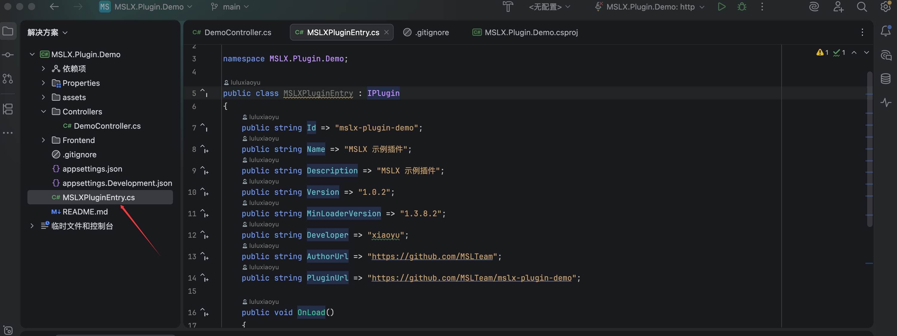
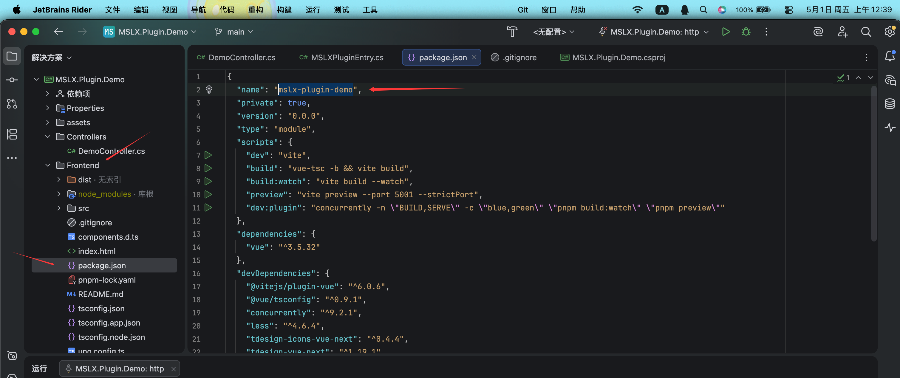
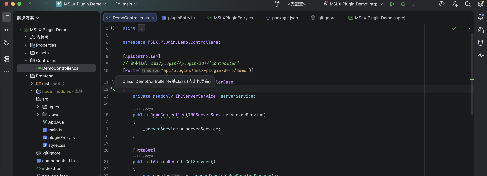
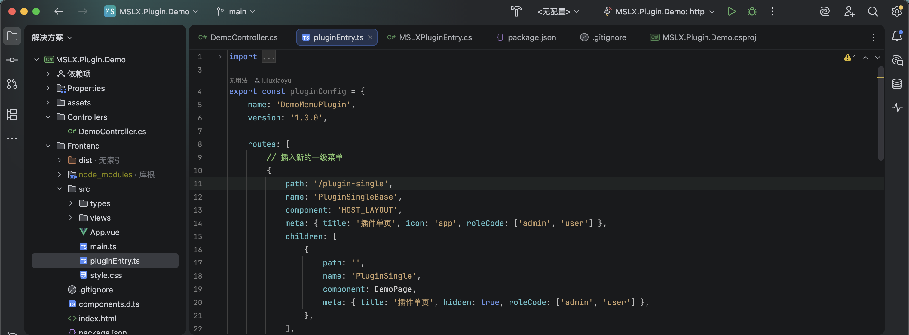

::: warning [已过时] 该方式已废弃
通过手动克隆 Demo 仓库并逐个文件全局查找替换元数据的方式已过时，容易遗漏并造成路由 404 或样式隔离失效。

现已推荐使用官方标准 .NET CLI 模板脚手架一键创建插件项目：
👉 **[使用模板创建插件项目（推荐）](/plugin-dev/init/quick-start/)**
:::

## 插件示例项目

插件的示例项目提供了简单的路由案例 + MSLX 内一些方法的调用示例 + MSLX 的配置读取示例。

<RepoCard repo="MSLTeam/mslx-plugin-demo" />

## 必须修改的地方

如果您依然选择直接克隆源码模板进行二次开发，那么必须根据以下步骤修改插件信息。

### 插件元数据与 ApplicationPart

在插件的入口文件 `MSLXPluginEntry.cs` 中，对 `Id` 等信息进行修改。

Id 是必须要改的，规范为：`mslx-plugin-xxx`。起名前建议到 Github 查询是否存在同名插件，以防撞车。

若您的插件包含 API 控制器（Controller），请同步将文件顶部的 `[assembly: ApplicationPart("MSLX.Plugin.Demo")]` 修改为您重命名后的程序集名称，确保宿主能够正确发现并注册路由。

### 前端项目名

进入 `Frontend/package.json`，修改 `name` 参数，和上述元数据的 `Id` 一致即可。

::: important 这里很重要，必须修改，否则可能造成CSS污染

:::

## 开始开发

改完上述内容后就可以开始对插件进行定制想要的功能了。

后端可供调用的方法可以查阅：[MSLX.SDK](https://github.com/MSLTeam/MSLX/tree/dev/MSLX.SDK) 。

路由都应该写在`Controllers`命名空间下，具体写法也可以参考`DemoController`。

前端插件的注册入口在`PluginEntry.js`。可以参考路由组件是如何进行注册的。

